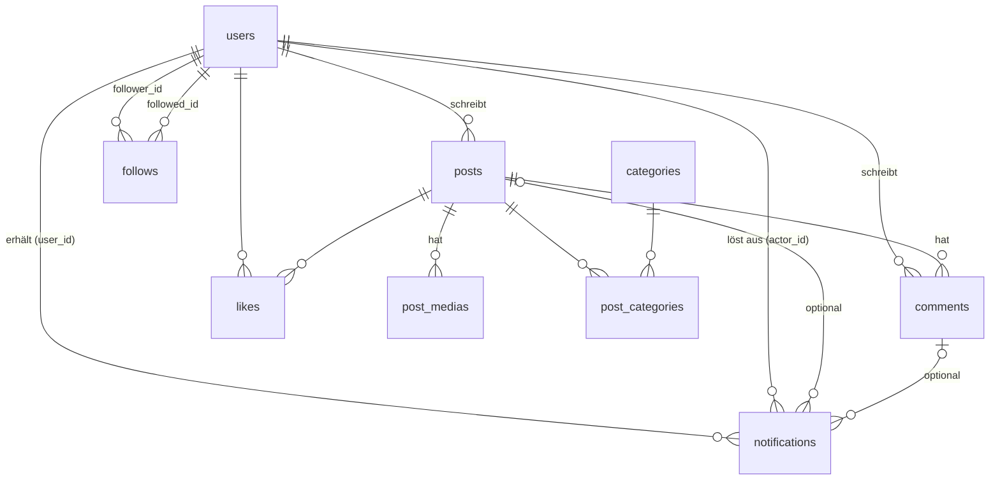

# Projektdokumentation – WebProjekt creativo (Gruppe 07)

Stand: 19.11.2026, Branch `Database`

Diese Dokumentation beschreibt den aktuellen Stand des Codes: welche Technik verwendet wird, wie das Projekt aufgebaut ist, wie eine Anfrage durch die App läuft, wie die Datenbank aussieht und wie man neue Funktionen ergänzt.

---

## Inhalt

1. [Überblick](#1-überblick)
2. [Projekt starten](#2-projekt-starten)
3. [Ordnerstruktur](#3-ordnerstruktur)
4. [Wie eine Anfrage verarbeitet wird](#4-wie-eine-anfrage-verarbeitet-wird)
5. [Routen](#5-routen)
6. [Authentifizierung (Registrierung, Login, Logout)](#6-authentifizierung-registrierung-login-logout)
7. [Datenbank](#7-datenbank)
8. [Models und Beziehungen](#8-models-und-beziehungen)
9. [Frontend: Views, Komponenten, CSS, JavaScript](#9-frontend-views-komponenten-css-javascript)
10. [Konfiguration](#10-konfiguration)
11. [Sicherheit](#11-sicherheit)
12. [Tests](#12-tests)
13. [Wichtige Befehle](#13-wichtige-befehle)
14. [Was fehlt noch / nächste Schritte](#14-was-fehlt-noch--nächste-schritte)

---

## 1. Überblick

**creativo** ist eine Plattform, auf der Nutzer kreative Arbeiten (Fotografie, Illustration, Design …) als Beiträge veröffentlichen. Andere Nutzer können Beiträge liken und kommentieren und einander folgen. Über Aktionen wird man per Benachrichtigung informiert.

### Technik

| Bereich | Technik | Wofür |
|---|---|---|
| Backend-Framework | **AdonisJS 7** (TypeScript, Node.js ≥ 24) | Routing, Controller, Middleware, Konfiguration |
| Datenbank / ORM | **Lucid** (ORM von AdonisJS) + **SQLite** (`better-sqlite3`) | Tabellen, Migrations, Models |
| Templates | **Edge.js** | HTML wird auf dem Server gerendert |
| Validierung | **VineJS** | Formulareingaben prüfen |
| Auth | `@adonisjs/auth` (Session-Guard) | Login per Session-Cookie |
| Sicherheit | `@adonisjs/shield` | CSRF-Schutz, Security-Header |
| Frontend-Build | **Vite** | CSS/JS bündeln, Hot Reload |
| Frontend-Interaktivität | **Alpine.js** | kleine Interaktionen (Theme-Umschalter, Alerts) |
| Icons | `edge-iconify` + Lucide-Icons | `@svg('lucide:house')` in Templates |
| Tests | **Japa** | Test-Runner (noch keine Tests geschrieben) |

Die App ist eine **klassische, serverseitig gerenderte Web-App** (kein React/Vue). Der Server liefert fertiges HTML, Formulare werden per normalem POST abgeschickt.

---

## 2. Projekt starten

```bash
npm install                 # Abhängigkeiten installieren
cp .env.example .env        # Umgebungsvariablen anlegen (nur beim ersten Mal)
node ace generate:key       # APP_KEY in .env erzeugen (nur beim ersten Mal)
node ace migration:run      # Tabellen anlegen
node ace db:seed            # Startdaten (Kategorien) einfügen
npm run dev                 # Dev-Server mit Hot Reload starten
```

Danach läuft die App unter **http://localhost:3333**.

Die Datenbank ist eine einzelne Datei: `tmp/db.sqlite3`. Sie wird **nicht** ins Git eingecheckt (`tmp/*` steht in `.gitignore`), jedes Teammitglied hat also seine eigene lokale Datenbank. Wer die Datenbank komplett neu aufsetzen will:

```bash
node ace migration:fresh --seed   # ACHTUNG: löscht alle Tabellen und Daten
```

### Umgebungsvariablen (`.env`)

Welche Variablen es gibt und welchen Typ sie haben, wird in [start/env.ts](../start/env.ts) geprüft. Fehlt eine, startet die App nicht.

| Variable | Beispiel | Bedeutung |
|---|---|---|
| `TZ` | `UTC` | Zeitzone |
| `PORT` | `3333` | Port des Servers |
| `HOST` | `localhost` | Host |
| `NODE_ENV` | `development` | `development`, `production` oder `test` |
| `LOG_LEVEL` | `info` | Wie viel geloggt wird |
| `APP_KEY` | (geheim) | Schlüssel zum Verschlüsseln/Signieren von Cookies |
| `APP_URL` | `http://localhost:3333` | Basis-URL der App |
| `SESSION_DRIVER` | `cookie` | Wo Sessions gespeichert werden |

---

## 3. Ordnerstruktur

```
├── adonisrc.ts              Zentrale AdonisJS-Konfiguration (Provider, Preloads, Tests)
├── ace.js                   Einstiegspunkt für die Kommandozeile (node ace …)
├── bin/                     Startskripte: server.ts, console.ts, test.ts
├── app/
│   ├── controllers/         Controller: Logik hinter den Routen
│   ├── exceptions/          Zentrale Fehlerbehandlung (handler.ts)
│   ├── middleware/          Middleware (auth, guest, …)
│   ├── models/              Lucid-Models (User, Post, …)
│   └── validators/          VineJS-Validatoren für Formulare
├── config/                  Konfiguration der einzelnen Pakete
├── database/
│   ├── migrations/          Migrations: erzeugen die Tabellen
│   ├── seeders/             Startdaten
│   ├── schema.ts            AUTOMATISCH GENERIERT: Spalten aller Tabellen
│   └── schema_rules.ts      Regeln für die Schema-Generierung (aktuell leer)
├── resources/
│   ├── css/app.css          Gesamtes Styling
│   ├── js/app.js            Alpine.js-Komponenten
│   └── views/               Edge-Templates (Seiten, Layouts, Komponenten)
├── start/
│   ├── routes.ts            Alle Routen
│   ├── kernel.ts            Middleware-Registrierung
│   ├── env.ts               Prüfung der Umgebungsvariablen
│   ├── validator.ts         Globale VineJS-Einstellungen
│   └── view.ts              Edge-Plugins (Icons)
├── tests/bootstrap.ts       Test-Setup (Japa)
├── tmp/                     Lokale SQLite-Datenbank (nicht im Git)
└── .adonisjs/               Von AdonisJS generierte Dateien (z. B. Controller-Index)
```

### Import-Aliase

In `package.json` sind Kurzpfade definiert, damit man keine langen relativen Pfade schreiben muss:

```ts
import User from '#models/user'               // → app/models/user.ts
import { signupValidator } from '#validators/user'
import { UserSchema } from '#database/schema'
import { middleware } from '#start/kernel'
import { controllers } from '#generated/controllers'  // → .adonisjs/server/controllers
```

---

## 4. Wie eine Anfrage verarbeitet wird

Am Beispiel „Nutzer schickt das Registrierungsformular ab“:

```
Browser  ──POST /signup──►  Server-Middleware  ──►  Router-Middleware  ──►  Route-Middleware  ──►  Controller  ──►  Antwort
                            (static, vite)          (bodyparser,           (guest)                NewAccount
                                                     session, shield,                             .store()
                                                     auth init,
                                                     silent auth)
```

1. **Server-Middleware** ([start/kernel.ts](../start/kernel.ts)) läuft bei *jeder* Anfrage:
   - `container_bindings_middleware`: stellt `HttpContext` und Logger für Dependency Injection bereit.
   - `static_middleware`: liefert Dateien aus `public/` aus.
   - `vite_middleware`: liefert im Dev-Modus CSS/JS über Vite aus.
2. **Router-Middleware** läuft bei jeder Anfrage, für die eine Route existiert:
   - `bodyparser`: liest Formulardaten/JSON aus dem Request.
   - `session`: lädt die Session (Cookie).
   - `shield`: prüft das CSRF-Token und setzt Security-Header.
   - `initialize_auth_middleware`: stellt `ctx.auth` bereit.
   - `silent_auth_middleware`: prüft, ob jemand eingeloggt ist (ohne umzuleiten). Dadurch ist `auth.user` in allen Templates verfügbar.
3. **Benannte Middleware** wird an einzelne Routen gehängt:
   - `guest`: nur für **nicht** eingeloggte Nutzer. Eingeloggte werden auf `/` umgeleitet.
   - `auth`: nur für eingeloggte Nutzer. Alle anderen werden auf `/login` umgeleitet.
4. Der **Controller** macht die eigentliche Arbeit und gibt eine Antwort zurück (HTML rendern oder umleiten).
5. Tritt ein Fehler auf, kümmert sich [app/exceptions/handler.ts](../app/exceptions/handler.ts) darum: Im Dev-Modus gibt es eine detaillierte Fehlerseite, in Produktion die Seiten `pages/errors/not_found` (404) bzw. `pages/errors/server_error` (500).

---

## 5. Routen

Definiert in [start/routes.ts](../start/routes.ts):

| Methode | URL | Name | Ziel | Middleware |
|---|---|---|---|---|
| GET | `/` | `home` | rendert `pages/home` | – |
| GET | `/signup` | `new_account.create` | `NewAccountController.create` | `guest` |
| POST | `/signup` | `new_account.store` | `NewAccountController.store` | `guest` |
| GET | `/login` | `session.create` | `SessionController.create` | `guest` |
| POST | `/login` | `session.store` | `SessionController.store` | `guest` |
| GET | `/dashboard` | `dashboard` | rendert `pages/dashboard` | `auth` |
| POST | `/logout` | `session.destroy` | `SessionController.destroy` | `auth` |

**Routennamen** werden automatisch aus Controller und Methode gebildet (`NewAccountController` + `store` → `new_account.store`). In Templates und Controllern verweist man über den Namen auf Routen statt über die URL:

```edge
@link({ route: 'session.create' }) Anmelden @end
```
```ts
response.redirect().toRoute('dashboard')
```

`controllers.NewAccount` kommt aus `#generated/controllers`. Diese Datei erzeugt AdonisJS automatisch aus allen Dateien in `app/controllers/`.

---

## 6. Authentifizierung (Registrierung, Login, Logout)

Die Anmeldung läuft über **Sessions**: Nach dem Login merkt sich der Server in einem verschlüsselten Cookie (`adonis-session`, 2 Stunden gültig), welcher User eingeloggt ist.

### Beteiligte Dateien

| Datei | Aufgabe |
|---|---|
| [config/auth.ts](../config/auth.ts) | Guard `web` (Session), lädt User über `#models/user` |
| [config/hash.ts](../config/hash.ts) | Passwörter werden mit **scrypt** gehasht |
| [app/models/user.ts](../app/models/user.ts) | `withAuthFinder(hash)`: hasht das Passwort beim Speichern automatisch und stellt `User.verifyCredentials()` bereit |
| [app/validators/user.ts](../app/validators/user.ts) | Regeln für die Registrierungs- und Login-Formulare |
| [app/controllers/new_account_controller.ts](../app/controllers/new_account_controller.ts) | Registrierung |
| [app/controllers/session_controller.ts](../app/controllers/session_controller.ts) | Login und Logout |
| [resources/views/pages/auth/](../resources/views/pages/auth/) | `signup.edge`, `login.edge` |

### Registrierung (`POST /signup`)

1. `signupValidator` prüft die Eingaben:
   - `displayName`: Pflichtfeld, 2–50 Zeichen, Leerzeichen am Rand werden entfernt
   - `email`: gültige E-Mail-Adresse, max. 254 Zeichen, darf in `users.email` noch nicht vorkommen
   - `password`: 8–32 Zeichen
   - `passwordConfirmation`: muss gleich `password` sein
2. Sind die Eingaben ungültig, leitet AdonisJS automatisch zurück zum Formular. Die Fehler stehen dann in `flashMessages` und werden von `@field.error()` unter dem jeweiligen Feld angezeigt. Die alten Eingaben bleiben erhalten (außer Passwörtern).
3. `User.create({ displayName, email, password })`: Das Passwort wird dabei automatisch gehasht.
4. Der User wird direkt eingeloggt und auf `/dashboard` weitergeleitet.

### Login (`POST /login`)

1. `loginValidator` prüft, ob E-Mail und Passwort vorhanden sind.
2. `User.verifyCredentials(email, password)` sucht den User und vergleicht den Passwort-Hash. Bei falschen Daten wird ein Fehler geworfen und man landet mit Fehlermeldung wieder beim Formular.
3. Login und Weiterleitung auf `/dashboard`.

### Logout (`POST /logout`)

Beendet die Session und leitet auf `/login` weiter. Logout ist bewusst ein **POST** (Button im Header in `layouts/app.edge`), damit fremde Seiten niemanden per Link ausloggen können.

### Eingeloggten User verwenden

```ts
// im Controller
async show({ auth }: HttpContext) {
  const user = auth.getUserOrFail()
}
```
```edge
{{-- im Template --}}
@if(auth.user)
  Hallo {{ auth.user.displayName }} ({{ auth.user.initials }})
@end
```

---

## 7. Datenbank

### 7.1 Einrichtung

- **Datenbank:** SQLite, Datei `tmp/db.sqlite3`
- **Konfiguration:** [config/database.ts](../config/database.ts). Dort sind auch PostgreSQL, MySQL, MSSQL und libSQL als auskommentierte Vorlagen enthalten, falls später gewechselt werden soll.
- Im Dev-Modus werden alle SQL-Abfragen formatiert im Terminal ausgegeben (`debug: app.inDev`, `prettyPrintDebugQueries`).

### 7.2 Migrations, Schema und Models

Die Datenbank wird in **drei Schichten** beschrieben:

```
database/migrations/*.ts   ──node ace migration:run──►   Tabellen in tmp/db.sqlite3
                                                                │
                                                                ▼ (wird automatisch ausgelesen)
                                                        database/schema.ts
                                                     (UserSchema, PostSchema, …)
                                                                │
                                                                ▼ extends
                                                        app/models/*.ts
                                                  (User, Post, … + Beziehungen)
```

1. **Migrations** ([database/migrations/](../database/migrations/)) beschreiben, welche Tabellen und Spalten es gibt. Jede Migration hat `up()` (anlegen) und `down()` (rückgängig machen). Sie werden in der Reihenfolge ihres Zeitstempels im Dateinamen ausgeführt.
2. **`database/schema.ts`** wird nach jeder Migration **automatisch neu erzeugt**. Darin steht pro Tabelle eine Klasse mit allen Spalten als TypeScript-Properties (in camelCase, z. B. `display_name` → `displayName`). **Diese Datei nie von Hand bearbeiten**, Änderungen werden beim nächsten Lauf überschrieben.
3. **Models** ([app/models/](../app/models/)) erben von diesen Klassen und ergänzen nur noch **Beziehungen** und eigene Methoden.

Wichtig: Spalten werden **nur in der Migration** geändert, nie im Model. Danach `node ace migration:run` (neue Migration) bzw. `node ace migration:fresh --seed` (bestehende Migration geändert, löscht alle Daten).

### 7.3 Tabellen

#### `users` – Benutzerkonten

| Spalte | Typ | Eigenschaften |
|---|---|---|
| `id` | integer | Primärschlüssel, auto-increment |
| `email` | string | Pflicht, **eindeutig** |
| `password` | string | Pflicht, scrypt-Hash (wird nie ausgegeben: `serializeAs: null`) |
| `display_name` | string | Pflicht, öffentlicher Anzeigename |
| `avatar_url` | string | optional, Profilbild |
| `bio` | text | optional, Profilbeschreibung |
| `created_at` | timestamp | Pflicht, Standard: jetzt |
| `updated_at` | timestamp | optional, wird bei Änderungen automatisch gesetzt |

#### `posts` – Beiträge

| Spalte | Typ | Eigenschaften |
|---|---|---|
| `id` | integer | Primärschlüssel |
| `user_id` | integer | Pflicht, → `users.id`, **CASCADE** |
| `title` | string | Pflicht |
| `caption` | text | optional, Beschreibung |
| `created_at` / `updated_at` | timestamp | wie bei `users` |

#### `post_medias` – Bilder/Dateien eines Beitrags

| Spalte | Typ | Eigenschaften |
|---|---|---|
| `id` | integer | Primärschlüssel |
| `post_id` | integer | Pflicht, → `posts.id`, CASCADE |
| `file_url` | string | Pflicht, Pfad/URL der Datei |
| `file_type` | string | Pflicht, z. B. `image/jpeg` |

Ein Beitrag kann mehrere Medien haben (z. B. eine Bildergalerie).

#### `categories` – Kategorien

| Spalte | Typ | Eigenschaften |
|---|---|---|
| `id` | integer | Primärschlüssel |
| `name` | string | Pflicht, **eindeutig** |
| `icon` | string | optional, z. B. ein Lucide-Iconname |
| `created_at` / `updated_at` | timestamp | optional |

Der Seeder legt die Kategorien **Fotografie**, **Illustration** und **Design** an.

#### `post_categories` – Verbindung Beitrag ↔ Kategorie (n:m)

| Spalte | Typ | Eigenschaften |
|---|---|---|
| `post_id` | integer | → `posts.id`, CASCADE |
| `category_id` | integer | → `categories.id`, CASCADE |

Primärschlüssel: (`post_id`, `category_id`). Dadurch kann ein Beitrag einer Kategorie nur einmal zugeordnet sein.

#### `likes` – User liked Beitrag (n:m)

| Spalte | Typ | Eigenschaften |
|---|---|---|
| `user_id` | integer | → `users.id`, CASCADE |
| `post_id` | integer | → `posts.id`, CASCADE |
| `created_at` | timestamp | Pflicht, Standard: jetzt |

Primärschlüssel: (`user_id`, `post_id`). Jeder User kann einen Beitrag nur einmal liken.

#### `follows` – User folgt User (n:m auf sich selbst)

| Spalte | Typ | Eigenschaften |
|---|---|---|
| `follower_id` | integer | → `users.id`, CASCADE (wer folgt) |
| `followed_id` | integer | → `users.id`, CASCADE (wem gefolgt wird) |
| `created_at` | timestamp | Pflicht, Standard: jetzt |

Primärschlüssel: (`follower_id`, `followed_id`).

#### `comments` – Kommentare

| Spalte | Typ | Eigenschaften |
|---|---|---|
| `id` | integer | Primärschlüssel |
| `post_id` | integer | Pflicht, → `posts.id`, CASCADE |
| `user_id` | integer | Pflicht, → `users.id`, CASCADE |
| `content` | text | Pflicht |
| `created_at` | timestamp | Pflicht, Standard: jetzt |

#### `notifications` – Benachrichtigungen

| Spalte | Typ | Eigenschaften |
|---|---|---|
| `id` | integer | Primärschlüssel |
| `user_id` | integer | Pflicht, → `users.id`: **wer** die Benachrichtigung bekommt |
| `actor_id` | integer | Pflicht, → `users.id`: **wer** die Aktion ausgelöst hat |
| `type` | string | Pflicht: `'like'`, `'comment'` oder `'follow'` |
| `post_id` | integer | optional, → `posts.id` (bei like/comment) |
| `comment_id` | integer | optional, → `comments.id` (bei comment) |
| `is_read` | boolean | Pflicht, Standard: `false` |
| `created_at` | timestamp | Pflicht, Standard: jetzt |

Beispiel: Anna liked einen Beitrag von Ben → `user_id = Ben`, `actor_id = Anna`, `type = 'like'`, `post_id = <Beitrag>`.

### 7.4 Beziehungsdiagramm



### 7.5 Löschverhalten (CASCADE)

Alle Fremdschlüssel haben `onDelete('CASCADE')`. Wird ein Eintrag gelöscht, löscht die Datenbank alles, was daran hängt, automatisch mit:

- **User löschen** → seine Posts (und damit deren Medien, Kommentare, Likes, Kategoriezuordnungen), seine Kommentare, Likes, Follows und Benachrichtigungen
- **Post löschen** → Medien, Kommentare, Likes, Kategoriezuordnungen, zugehörige Benachrichtigungen
- **Kommentar löschen** → zugehörige Benachrichtigungen

### 7.6 Seeder

[database/seeders/category_seeder.ts](../database/seeders/category_seeder.ts) legt die Startkategorien an. Ausführen mit `node ace db:seed`. Wenn man ihn zweimal ausführt, gibt es einen Fehler, weil `categories.name` eindeutig sein muss. Zum Zurücksetzen `node ace migration:fresh --seed` verwenden.

---

## 8. Models und Beziehungen

Alle Models liegen in [app/models/](../app/models/). Für die Verbindungstabellen `likes`, `follows` und `post_categories` gibt es **kein eigenes Model**, sie werden über `manyToMany`-Beziehungen angesprochen.

| Model | Tabelle | Beziehungen |
|---|---|---|
| `User` | `users` | `posts` (hasMany), `comments` (hasMany), `notifications` (hasMany), `likedPosts` (manyToMany über `likes`), `following` / `followers` (manyToMany über `follows`) |
| `Post` | `posts` | `user` (belongsTo), `media` (hasMany → `PostMedia`), `comments` (hasMany), `categories` (manyToMany über `post_categories`), `likedBy` (manyToMany über `likes`) |
| `PostMedia` | `post_medias` | `post` (belongsTo) |
| `Category` | `categories` | `posts` (manyToMany über `post_categories`) |
| `Comment` | `comments` | `user` (belongsTo), `post` (belongsTo) |
| `Notification` | `notifications` | `user` (belongsTo, Empfänger), `actor` (belongsTo, Fremdschlüssel `actorId`), `post` (belongsTo), `comment` (belongsTo) |

### Besonderheiten

- **`User`** wird mit `compose(UserSchema, withAuthFinder(hash))` gebaut. Das ergänzt automatisches Passwort-Hashing und `User.verifyCredentials()`.
- **`User.initials`** (Getter) gibt die Initialen zurück: die Anfangsbuchstaben der ersten beiden Wörter von `displayName` („Ada Lovelace“ → „AL“), bei nur einem Wort die ersten zwei Buchstaben („Ada“ → „AD“).
- **`following` / `followers`** verwenden dieselbe Tabelle `follows`, nur mit vertauschten Spalten:
  - `following`: Leute, denen ich folge (`follower_id = ich`)
  - `followers`: Leute, die mir folgen (`followed_id = ich`)

### Beispiele

```ts
import User from '#models/user'
import Post from '#models/post'
import Category from '#models/category'

// Beitrag mit Bildern und Kategorien anlegen
const post = await user.related('posts').create({ title: 'Sonnenuntergang', caption: 'Am Rhein' })
await post.related('media').create({ fileUrl: '/uploads/sunset.jpg', fileType: 'image/jpeg' })
const foto = await Category.findByOrFail('name', 'Fotografie')
await post.related('categories').attach([foto.id])

// Feed: neueste Beiträge mit Autor, Medien, Kategorien und Anzahl der Likes/Kommentare
const posts = await Post.query()
  .preload('user')
  .preload('media')
  .preload('categories')
  .withCount('likedBy')
  .withCount('comments')
  .orderBy('created_at', 'desc')
// Zugriff auf die Zahlen: post.$extras.likedBy_count, post.$extras.comments_count

// Liken / Like entfernen
await user.related('likedPosts').attach([post.id])
await user.related('likedPosts').detach([post.id])

// Folgen / Entfolgen
await user.related('following').attach([otherUser.id])
await user.related('following').detach([otherUser.id])

// Kommentieren und Benachrichtigung anlegen
const comment = await post.related('comments').create({ userId: user.id, content: 'Tolles Bild!' })
await Notification.create({
  userId: post.userId, actorId: user.id, type: 'comment', postId: post.id, commentId: comment.id,
})

// Ungelesene Benachrichtigungen eines Users
const unread = await user.related('notifications').query()
  .where('is_read', false)
  .preload('actor')
  .orderBy('created_at', 'desc')
```

---

## 9. Frontend: Views, Komponenten, CSS, JavaScript

### 9.1 Seiten (`resources/views/pages/`)

| Datei | Beschreibung |
|---|---|
| `home.edge` | Startseite (noch die Willkommensseite aus dem AdonisJS-Starter-Kit) |
| `dashboard.edge` | Dashboard nach dem Login (noch leer) |
| `auth/signup.edge` | Registrierungsformular (Anzeigename, E-Mail, Passwort, Passwort bestätigen) |
| `auth/login.edge` | Login-Formular |
| `errors/not_found.edge` | 404-Seite |
| `errors/server_error.edge` | 500-Seite |

### 9.2 Layouts (`resources/views/components/layouts/`)

Layouts sind das Grundgerüst einer Seite (`<html>`, `<head>`, Header). Eine Seite benutzt ein Layout so:

```edge
@layouts.app({ title: 'Dashboard' })
  ... Inhalt der Seite ...
@end
```

| Layout | Verwendung |
|---|---|
| `app.edge` | Seiten für eingeloggte Nutzer: Header mit Logo, Theme-Umschalter, Logout-Button und eine Navigation. Neue Menüpunkte trägt man oben in der Liste `nav` ein. |
| `auth.edge` | Login/Registrierung: zweispaltig, links das Formular, rechts eine Infospalte |
| `marketing.edge` | Öffentliche Seiten wie die Startseite |
| `settings.edge` | Vorlage für Einstellungsseiten (noch nicht verwendet) |

### 9.3 Komponenten (`resources/views/components/`)

Wiederverwendbare Bausteine. Der Dateipfad ergibt den Namen: `components/field/label.edge` → `@field.label()`. Das `!` in `@!komponente()` bedeutet, dass die Komponente keinen Inhalt zwischen Start- und End-Tag hat.

| Komponente | Zweck |
|---|---|
| `@form({ route, method })` | Formular. Fügt automatisch das **CSRF-Token** ein und baut die URL aus dem Routennamen. |
| `@field.root({ name })` | Umschließt ein Formularfeld und gibt Name, ID, alten Wert und Fehler an die enthaltenen Komponenten weiter |
| `@field.label`, `@field.error` | Beschriftung bzw. Fehlermeldung eines Feldes |
| `@input.control`, `@textarea.control`, `@select.control` | Eingabefelder. Nach einem Validierungsfehler wird der alte Wert automatisch wieder eingesetzt (außer bei Passwörtern). |
| `@checkbox.*`, `@radio.*` | Checkboxen und Radio-Buttons inkl. Gruppen |
| `@button({ text, variant, size, block })` | Button (`variant`: z. B. `primary`, `secondary`) |
| `@link({ route })` | Link über einen Routennamen |
| `@navLink({ route })` | Navigationslink, wird automatisch als aktiv markiert (`aria-current`) |
| `@alert.root/.title/.description` | Hinweisboxen (z. B. für Flash-Messages) |
| `@avatar({ src, initials })` | Profilbild oder ersatzweise die Initialen |
| `@logo`, `@themeToggle`, `@page`, `@section` | Logo, Hell/Dunkel-Umschalter, Seiten- und Abschnittscontainer |

Typisches Formularfeld:

```edge
@field.root({ name: 'email' })
  @!field.label({ text: 'E-Mail' })
  @!input.control({ type: 'email' })
  @!field.error()
@end
```

### 9.4 Flash-Messages

[partials/flash_alerts.edge](../resources/views/partials/flash_alerts.edge) zeigt Meldungen an, die ein Controller vor einer Weiterleitung setzt. Sie verschwinden nach 5 Sekunden automatisch:

```ts
session.flash('success', 'Beitrag veröffentlicht!')
session.flash('error', 'Etwas ist schiefgelaufen.')
```

### 9.5 CSS und JavaScript

- **[resources/css/app.css](../resources/css/app.css)**: das gesamte Styling, mit CSS-Variablen für Hell- und Dunkelmodus (`data-theme` am `<html>`-Tag).
- **[resources/js/app.js](../resources/js/app.js)**: Alpine.js mit zwei Komponenten:
  - `alert`: blendet Hinweise ein und nach 5 s wieder aus
  - `themeToggle`: schaltet zwischen hell und dunkel um und speichert die Wahl im Cookie `app_theme` (1 Jahr). Der Server liest das Cookie aus, damit die Seite gleich im richtigen Modus lädt.
- Beide Dateien werden von **Vite** gebündelt und im Layout mit `@vite([...])` eingebunden.
- **Icons:** `@svg('lucide:icon-name', { width: 16, height: 16 })`. Alle Lucide-Icons sind verfügbar (eingerichtet in [start/view.ts](../start/view.ts)).

---

## 10. Konfiguration

| Datei | Inhalt |
|---|---|
| [adonisrc.ts](../adonisrc.ts) | Registrierte Provider (Pakete), Preloads (`routes`, `kernel`, `validator`, `view`), Test-Suites, Dateien für den Production-Build |
| [config/app.ts](../config/app.ts) | HTTP-Einstellungen: Request-IDs, Method Spoofing (`_method` in Formularen für PUT/DELETE), Cookie-Standards |
| [config/auth.ts](../config/auth.ts) | Session-Guard `web` |
| [config/bodyparser.ts](../config/bodyparser.ts) | Verarbeitung von Formularen, JSON und Datei-Uploads (multipart) |
| [config/database.ts](../config/database.ts) | Datenbankverbindung (SQLite) |
| [config/encryption.ts](../config/encryption.ts) | Verschlüsselung mit `APP_KEY` |
| [config/hash.ts](../config/hash.ts) | Passwort-Hashing (scrypt) |
| [config/logger.ts](../config/logger.ts) | Logging (im Dev-Modus formatiert mit `pino-pretty`) |
| [config/session.ts](../config/session.ts) | Session-Cookie `adonis-session`, 2 h gültig, `httpOnly`, `sameSite: lax` |
| [config/shield.ts](../config/shield.ts) | CSRF, X-Frame-Options, HSTS, Schutz vor Content-Type-Sniffing |
| [config/static.ts](../config/static.ts) | Auslieferung statischer Dateien aus `public/` |
| [config/vite.ts](../config/vite.ts) | Wo die gebündelten Assets liegen (`public/assets`) |
| [start/validator.ts](../start/validator.ts) | VineJS gibt Datumswerte als Luxon-`DateTime` zurück (passend zu Lucid) |

---

## 11. Sicherheit

Diese Schutzmaßnahmen sind schon aktiv:

- **Passwörter** werden mit scrypt gehasht und nie im Klartext gespeichert. Beim Umwandeln eines Users in JSON wird das Passwortfeld weggelassen (`serializeAs: null`).
- **CSRF-Schutz:** Jedes POST/PUT/PATCH/DELETE-Formular braucht ein gültiges `_csrf`-Token. Die Komponente `@form` fügt es automatisch ein. Eigene `<form>`-Tags brauchen `{{ csrfField() }}`.
- **Session-Cookies** sind `httpOnly` (für JavaScript nicht lesbar), in Produktion nur über HTTPS (`secure`), und mit `sameSite: lax` versehen.
- **Clickjacking-Schutz:** Die Seite darf nicht in einem iframe eingebettet werden (`X-Frame-Options: DENY`).
- **Edge escaped Ausgaben** mit `{{ }}` automatisch (Schutz vor XSS). `{{{ }}}` gibt Inhalt *ungefiltert* aus und darf nur für vertrauenswürdigen Inhalt verwendet werden, **nie für Nutzereingaben** wie Kommentare oder Bio-Texte.
- **Content Security Policy** ist aktuell **deaktiviert** (`csp.enabled: false` in `config/shield.ts`).

---

## 12. Tests

- Test-Runner: **Japa**, eingerichtet in [tests/bootstrap.ts](../tests/bootstrap.ts) (inkl. Datenbank-Assertions, Browser-Client und Auth-Helfern).
- Test-Suites (siehe `adonisrc.ts`): `tests/unit/**`, `tests/functional/**`, `tests/browser/**`
- **Es gibt noch keine Tests.** Ausführen mit `npm test` bzw. `node ace test`.
- Neuen Test anlegen: `node ace make:test <name> --suite=functional`

---

## 13. Wichtige Befehle

| Befehl | Wirkung |
|---|---|
| `npm run dev` | Dev-Server mit Hot Reload |
| `npm run build` / `npm start` | Production-Build erstellen bzw. starten |
| `npm run lint` / `npm run format` | ESLint / Prettier |
| `npm run typecheck` | TypeScript-Typprüfung |
| `node ace migration:run` | Neue Migrations ausführen (aktualisiert `database/schema.ts`) |
| `node ace migration:rollback` | Letzten Migrationslauf rückgängig machen |
| `node ace migration:fresh --seed` | Alle Tabellen löschen, neu anlegen, Seeder ausführen (**alle Daten weg**) |
| `node ace migration:status` | Zeigt, welche Migrations schon gelaufen sind |
| `node ace db:seed` | Seeder ausführen |
| `node ace make:migration <name>` | Neue Migration anlegen |
| `node ace make:model <Name>` | Neues Model anlegen |
| `node ace make:controller <name>` | Neuen Controller anlegen |
| `node ace make:validator <name>` | Neuen Validator anlegen |
| `node ace make:seeder <name>` | Neuen Seeder anlegen |
| `node ace list:routes` | Alle Routen anzeigen |
| `node ace repl` | Interaktive Konsole (z. B. Models ausprobieren) |

### Ablauf: Neue Funktion hinzufügen (Beispiel „Beitrag erstellen“)

1. **Datenbank:** Tabelle existiert schon (`posts`). Sonst `node ace make:migration`, Spalten eintragen, `node ace migration:run`.
2. **Validator:** `node ace make:validator post` → Regeln für `title`, `caption` usw.
3. **Controller:** `node ace make:controller posts` → Methoden `create` (Formular anzeigen) und `store` (speichern).
4. **Routen** in `start/routes.ts` in der `auth`-Gruppe eintragen:
   ```ts
   router.get('posts/new', [controllers.Posts, 'create'])
   router.post('posts', [controllers.Posts, 'store'])
   ```
5. **View** `resources/views/pages/posts/create.edge` mit `@layouts.app` und `@form`-Komponenten anlegen.
6. Falls nötig einen Menüpunkt in der `nav`-Liste in `layouts/app.edge` ergänzen.

---

## 14. Was fehlt noch / nächste Schritte

**Fertig:**
- Projektgrundgerüst (AdonisJS-Starter-Kit) mit Layouts, Komponenten und Theme-Umschalter
- Registrierung, Login und Logout
- Vollständiges Datenbankschema (9 Tabellen) mit Models und allen Beziehungen
- Seeder für Kategorien

**Offen:**
- Controller, Routen und Seiten für **Beiträge** (erstellen, anzeigen, Feed, bearbeiten, löschen)
- **Datei-Upload** für Bilder (`post_medias`). Der Bodyparser unterstützt Uploads bereits, aber es gibt noch keinen Speicherort (z. B. `public/uploads` oder `@adonisjs/drive`).
- **Likes, Kommentare, Folgen** inkl. Erstellen der Benachrichtigungen
- **Benachrichtigungsseite** (ungelesene anzeigen, als gelesen markieren)
- **Profilseite** und Profil bearbeiten (`display_name`, `bio`, `avatar_url`)
- **Kategorienfilter** im Feed
- Startseite und Dashboard mit eigenen Inhalten statt der Starter-Kit-Texte; Texte ggf. auf Deutsch
- Prüfen, dass nur der Autor seine Beiträge bearbeiten/löschen darf (z. B. mit `@adonisjs/bouncer`)
- Ggf. verhindern, dass ein User sich selbst folgt (`follower_id ≠ followed_id`)
- Tests schreiben
